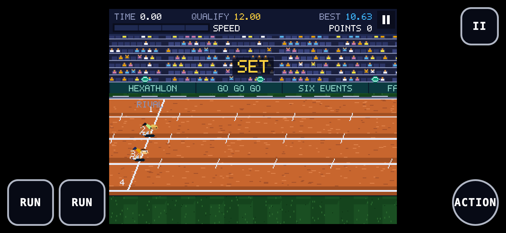
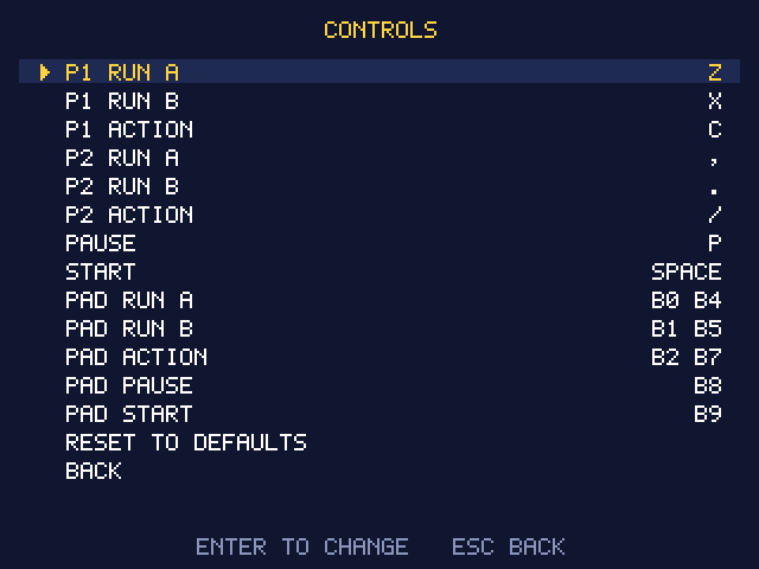
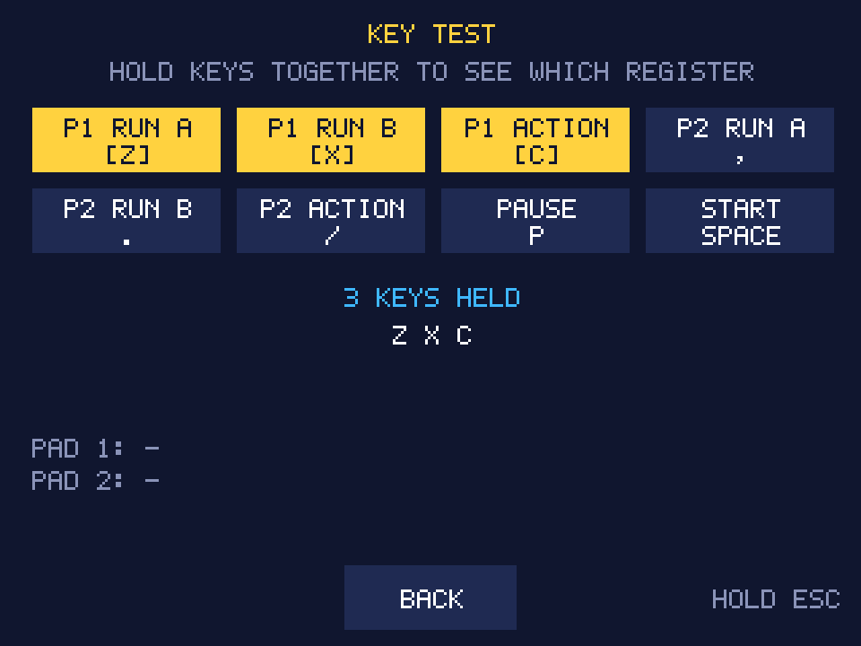

# Controls

[Back to README](../../README.md)

Hexathlon plays with a keyboard, a touch screen or a gamepad. Every device
feeds the same actions: RUN A, RUN B and ACTION for each player, plus PAUSE
and START, and Up, Down, Left and Right in the menus.

## Keyboard

| Action | Player 1 | Player 2 |
|---|---|---|
| Run (alternate) | `Z` / `X` | `,` / `.` |
| Action (jump / throw; hold for angle) | `C` | `/` |
| Pause | `Esc` or `P` | `Esc` or `P` |
| Start | `Enter` or `Space` | `Enter` or `Space` |
| Menus | Arrow keys to move, `Enter` (or Action) to choose, `Esc` to go back | |
| Full screen on or off | `F` | `F` |

The two players' keys sit at opposite ends of the keyboard, so four run keys
and two action keys are less likely to ghost when held together. Player 2's
keys are used in [Two Player](how-to-play.md#two-player) Sessions.

Details:

- Keys are read by physical position (`KeyboardEvent.code`), so the layout
  is the same on any keyboard language.
- Holding a key down sends one press; auto-repeat is ignored.
- Keys pressed with `Ctrl`, `Alt` or `Cmd` are left to the browser.
- `Enter` and `Space` never pause an Event, so they can't pause by accident.
- `F` turns [Full Screen](settings.md#full-screen) on and off anywhere,
  even mid-Event, except while you type initials, choose a key on the remap
  screen or use the Key Test. If you remap `F` to a game control, it does
  that instead, and Full Screen stays in Settings.
- In the menus, Left and Right change a value (for example Difficulty or
  Volume).

## Touch

On a touch screen, on-screen buttons appear once you touch it (or straight
away on a touch-only device). Touch plays one player.

| Where | Buttons |
|---|---|
| During an Event | Two RUN buttons side by side at the bottom left, a big ACTION button at the bottom right, and a pause button (II) at the top right |
| Menus, and the pause menu | A row of arrows (◀ ▲ ▼ ▶) along the bottom, with BACK above the left end and OK above the right end |
| Title and Attract Mode | None: any tap will do |

- Every button is at least 64 CSS pixels and at most 96, and they scale with
  the screen.
- Every finger is tracked separately, so you can hold both RUN buttons and
  ACTION together, and slide a finger from one button to another.
- You can also tap the screen itself: tap a menu row to pick it, tap the left
  or right end of a value row to change it, and tap the pause icon to pause.
- On the initials screen, tap the arrows above and below each letter and tap
  END.
- The page stops the browser treating fast taps as zoom, scroll or text
  selection.

Two Player is hidden from the main menu on touch-only devices.

## Gamepad

The first gamepad plays as player 1 and the second as player 2. Both use the
same button layout. Pads are polled every frame through the Gamepad API.

Defaults, in the standard layout:

| Action | Buttons |
|---|---|
| RUN A | A (bottom face button) or left shoulder (LB) |
| RUN B | B (right face button) or right shoulder (RB) |
| ACTION | X (left face button) or right trigger (RT) |
| PAUSE | Back / Select |
| START | Start (also pauses during an Event) |
| Menus | D-pad or left stick |

Analogue triggers count as held above half way. The d-pad is kept for the
menus and can't be remapped.

## Remapping

Settings > Controls lists every remappable control:

- P1 RUN A, P1 RUN B, P1 ACTION, P2 RUN A, P2 RUN B, P2 ACTION, PAUSE and
  START (keyboard);
- PAD RUN A, PAD RUN B, PAD ACTION, PAD PAUSE and PAD START (shared by both
  pads).

Pick a row, then press the new key or pad button. `Esc` or a tap cancels, and
the capture gives up after 8 seconds.

- A key already used by another action is refused ("Z IS USED BY P1 RUN
  A"), so two actions never share a key.
- The arrow keys, `Enter` and `Escape` are kept for the menus and can't be
  bound, so the menus (including this screen) can never be locked out.
- RESET TO DEFAULTS restores every key and pad button.

Changes apply at once and are saved in local storage under
`hexathlon:controls`.

## Key Test

Settings > Key Test shows, live, every key and pad button you are holding.
Cheap keyboards can't register some combinations of held keys (ghosting).
Hold the run and action keys of both players together to see whether yours
can.

- A box for each game action lights up while its key is held.
- Below, every held key is listed, bound or not, with a count.
- PAD 1 and PAD 2 list the buttons held on each pad and the actions they
  trigger.
- A quick `Esc` is just another key to test. **Hold `Esc` for one second**,
  or tap BACK, to leave.

## Code

| File | What it does |
|---|---|
| `src/input.ts` | Keyboard bindings, remapping and the timestamped input queue |
| `src/touch.ts` | Touch button layout and pointer tracking |
| `src/gamepad.ts` | Gamepad polling, default pad bindings and pad remapping |
| `src/scenes/controls.ts` | The Controls screen |
| `src/scenes/key-test.ts` | The Key Test screen |

Input is timestamped when it happens and consumed by the fixed 60 Hz step it
falls in, so every press lands in exactly one frame and none are dropped.
