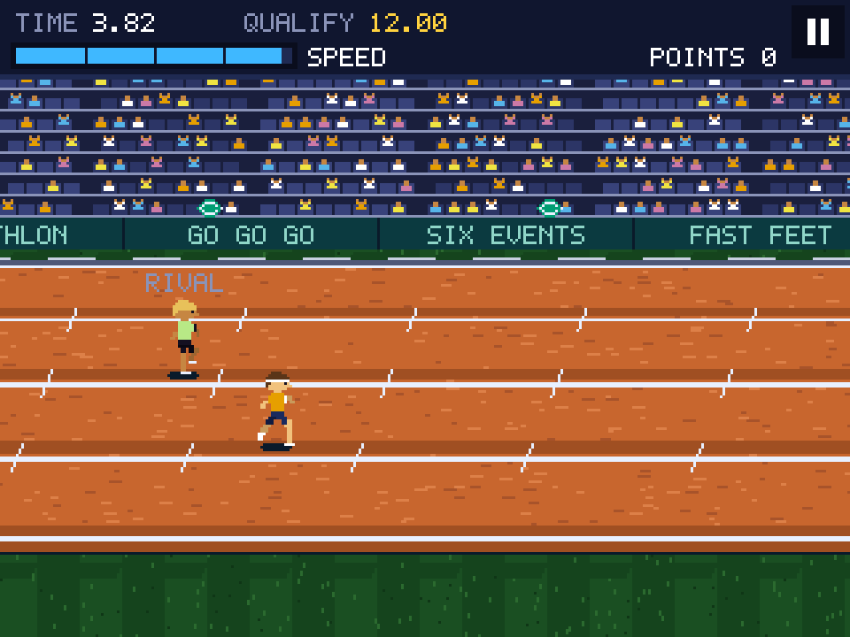
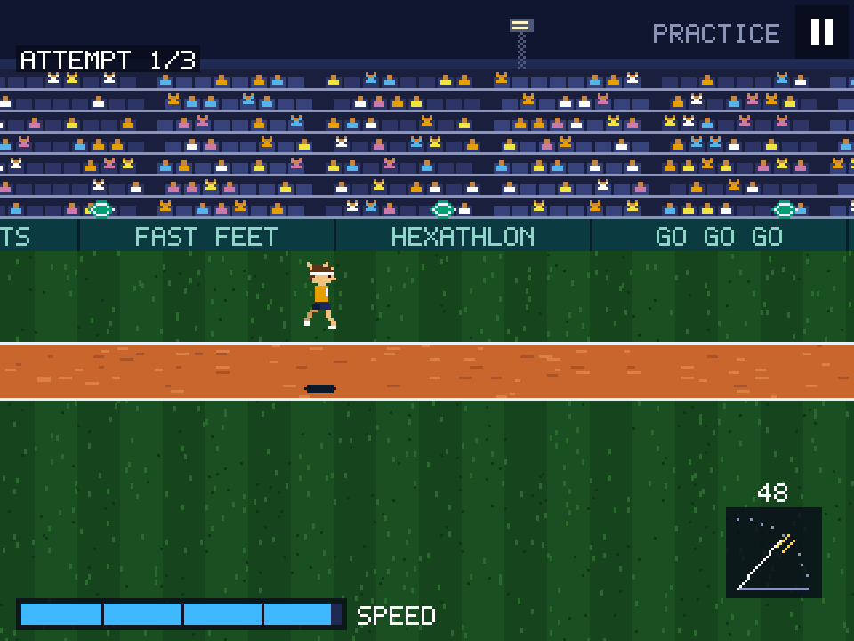
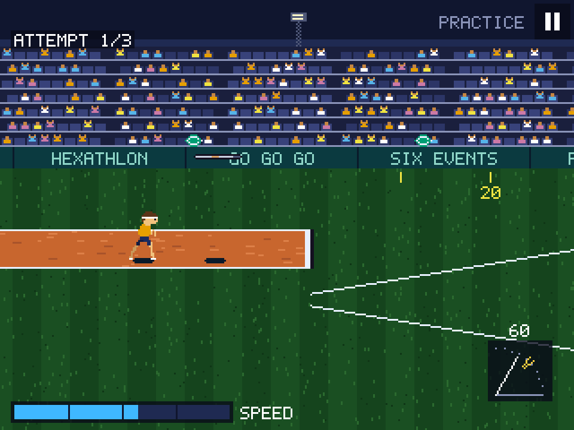
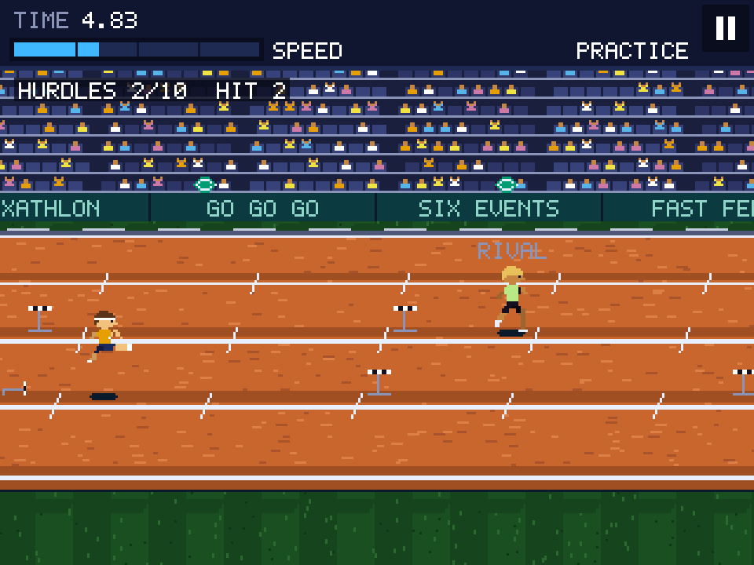
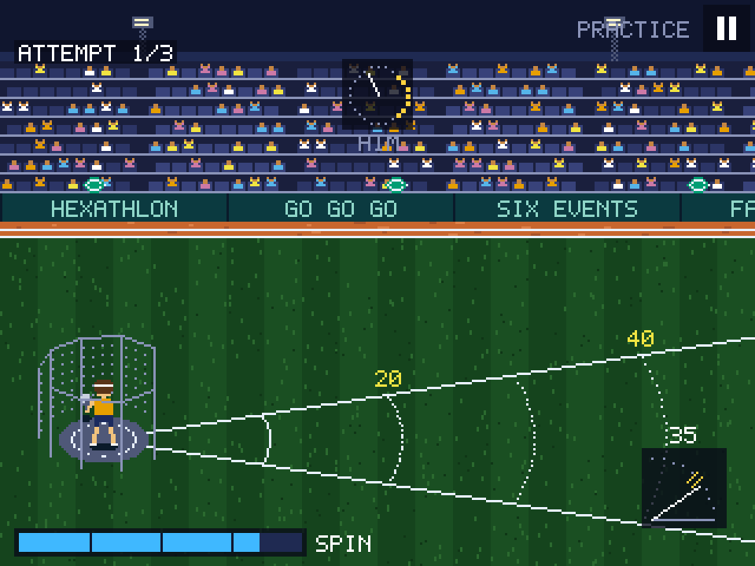
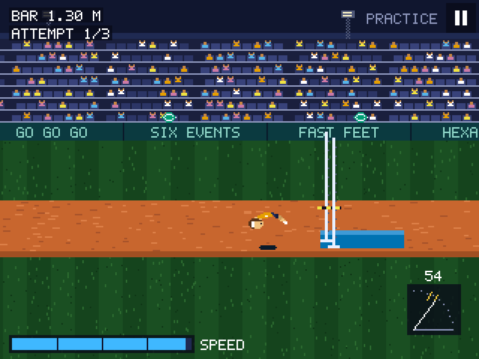

# Events

[Back to README](../../README.md)

The six Events, in the order a Session plays them. Each section says how to
play the Event, which controls it uses, how many Attempts you get, what
counts as a foul, what the Mark is and how the Standard works.

After every Attempt the athlete reacts for a moment before the game moves
on: passing it (reaching the Standard in Arcade; a valid Mark, or beating the
Rival, in Practice; clearing the bar in the High Jump), they jump up and down
with their arms in the air; failing it, they bow their head and shake it,
and the game holds on them for a few seconds before moving on.
The announcer calls the start, fouls and qualifying (see
[Settings](settings.md#announcer)).

Controls are named by action. With the default keys, player 1's RUN A and
RUN B are `Z` and `X`, and ACTION is `C`. See [Controls](controls.md) for
touch and gamepads.

All numbers here come from `data/events.json`, `data/standards.json` and
`data/points.json` at Normal difficulty. They are **provisional** until the
reference data is captured (see [Calibration and parity](calibration-and-parity.md)).
The simulation works in the original's pixels and 60 Hz frames
([ADR-0004](../architectural-decision-record/0004-sim-in-original-pixels-and-frames.md));
times are shown in seconds and distances in metres only on screen.

## Shared rules

### The speed meter

Every Event uses the same speed meter (`src/sim/speed.ts`, the `speed` block
in `data/events.json`):

- Each press of the **other** run key adds speed (`gainPerAlternation`).
  Pressing the same key again adds nothing (`sameKeyGain` is 0). The very
  first press counts as an alternation.
- The meter decays every frame, by a share of its value plus a small fixed
  amount, and is capped at a maximum. In the Hammer Throw the share is
  halved, so the spin fades more slowly.
- Every press in a frame is counted before decay, so no press is lost
  however fast you mash. Keyboard auto-repeat is ignored.

The speed bar at the bottom left of the screen shows the meter, with notches
every quarter.

### Angles in the field Events

The Long Jump, Javelin Throw, Hammer Throw and High Jump share the same angle
control (`src/sim/field.ts`, the `field` block):

- Press ACTION and the angle starts at 0 degrees. Hold it and the angle rises
  by 1.5 degrees a frame, up to 80 degrees.
- Let go to commit the angle. Holding for a full second (60 frames) commits
  it anyway. A quick tap commits at once.
- Each Event has an **angle window**. Inside it the launch is at full
  strength. Outside it you lose a share of the distance per degree, down to a
  floor of 30%.
- The angle dial at the bottom right shows the needle and the window as
  ticks.

| Event | Angle window | Roughly how long to hold |
|---|---|---|
| Long Jump | 40 to 46 degrees | about half a second |
| Javelin Throw | 42 to 48 degrees | about half a second |
| Hammer Throw | 40 to 46 degrees | about half a second |
| High Jump | 55 to 65 degrees | about two thirds of a second |

Easy widens every window by 4 degrees each side, Hard narrows it by 2 (see
[Settings](settings.md#difficulty)).

### The Rival

The 100m Dash and 110m Hurdles are raced against the **Rival** in the next
lane (`src/sim/rival.ts`). Its reaction time, acceleration and top speed are
set per Cycle and get quicker each Cycle, up to a cap. Its small pace
variation is seeded, so the same inputs always give the same race. The
results show the Rival's time. Beating the Rival is not required: only the
Standard decides whether you qualify.

### Run-up time

In the Long Jump, Javelin Throw and High Jump the Run-up has a time limit of
20 seconds (`maxRunUpFrames`, 1200 frames). In the Hammer Throw the spin has
a limit of 15 seconds (`maxSpinFrames`, 900 frames). Running out is a foul.

## 1. 100m Dash

**How to play.** The athlete crouches in the blocks. Wait for the start
signal, then mash RUN A and RUN B in turn to sprint to the finish line.

**Controls.** RUN A and RUN B only.

**Status panel.** Along the top of the screen: the race time, the time to
QUALIFY (in Arcade), your BEST time, the speed bar (one per player in a
two-player race) and the Points.

**Track.** Seen from high in the stand: the lanes get taller towards you and
the start, finish and distance lines lean in perspective.

**Start and false starts.** The screen shows ON YOUR MARKS, then SET, then
GO!, and the announcer calls "On your marks" and "Get set" before the gun. The start signal comes 2 seconds (120 frames) after the set position
begins. A run press before it is a false start. The first false start is
forgiven ("FALSE START 1 OF 2") and the start sequence begins again; the
second disqualifies you (`falseStartsAllowed` is 1). A disqualification
shows DISQUALIFIED, then FALSE START on the results, earns no Mark and no
Points, and ends an Arcade Session.

**Finish.** The screen shows YOU WIN or RIVAL WINS.

**Attempts.** One.

**Mark.** Your time from the start signal to the finish line, in seconds
to two places. The race length is 1700 pixels.

**Rival.** Runs in lane 2, you in lane 3.

**Standard.** At or under the time shown (12.00 s in Cycle 1 at Normal).

## 2. Long Jump

**How to play.** Mash along the Run-up. Before the foul line, press ACTION to
take off, hold it to raise the take-off angle, and let go to jump. Your
speed at take-off and the angle decide the distance. Mashing stops counting
once you press ACTION.

**Controls.** RUN A, RUN B and ACTION.

**Fouls.**

- Pressing ACTION when already past the foul line (TOO LATE - OVER THE LINE).
- Running past the foul line without taking off (OVER THE LINE).
- Not taking off within the Run-up time (OUT OF TIME).

A foul shows a crossed flag and the reason, and earns no Mark.

**Officials.** A judge sits on a stool by the take-off board, watching the
foul line. Once the jump is decided they raise a flag: white for a valid
jump, the crossed foul flag for a foul, and the announcer calls "Foul". After
a valid jump the measurer walks out along the pit with the tape and crouches
at the landing mark; the distance shows once it is measured. The camera
stops at the board so the judge stays in view.

**Attempts.** Three in Arcade. Your best valid Mark counts. Reaching the
Standard ends the Event early. In Practice each go is one Attempt.

**Mark.** The distance from the foul line to the landing, so taking off
close to the line matters.

**Standard.** At or over the distance shown (5.50 m in Cycle 1 at Normal).

## 3. Javelin Throw

**How to play.** Mash along the Run-up. Press ACTION to start the throw, hold
it to raise the release angle, and let go to release. You keep running (and
mashing still counts) until you let go. After release the athlete slows to a
stop and must stay behind the foul line.

**Controls.** RUN A, RUN B and ACTION.

**Fouls.**

- Crossing the foul line before the release, or during the follow-through
  before the javelin lands (OVER THE LINE).
- Not throwing within the Run-up time (OUT OF TIME).

**Attempts.** Three in Arcade, best valid Mark counts, and reaching the
Standard ends the Event early. One per go in Practice.

**Mark.** The distance from the foul line to where the javelin lands.

**Standard.** At or over the distance shown (50.00 m in Cycle 1 at Normal).

## 4. 110m Hurdles

**How to play.** The same start as the 100m Dash, then mash to run and press
ACTION to jump each of the 10 hurdles.

**Controls.** RUN A, RUN B and ACTION.

**Clearing a hurdle.** A jump lasts 24 frames. A hurdle is cleared if you
pass it between 6 and 20 frames after take-off (the clear window). You can't
jump again until the current jump has landed. Otherwise you hit it: the
hurdle goes down, you lose 45% of your speed, and you stumble for 18 frames,
during which run presses add nothing. Hitting a hurdle is not a foul; it just
costs time.

Easy widens the clear window by 3 frames each side, Hard narrows it by 2.

**False starts.** As in the 100m Dash: one is forgiven, the second
disqualifies.

**Attempts.** One.

**Mark.** Your time from the start signal to the finish line. The first
hurdle is 233 pixels from the start, then one every 155 pixels, and the
finish is at 1870 pixels.

**Rival.** Runs in the next lane, at its own per-Cycle pace.

**Standard.** At or under the time shown (14.00 s in Cycle 1 at Normal).

## 5. Hammer Throw

**View.** An overview from high above: the throwing circle in its cage at
the left, and the landing sector fanning out across the field with an arc
every 10 metres. The ball swings round the thrower on its wire, and once
thrown flies out over the sector with its shadow on the grass, the camera
following it. Then the camera returns to the circle for the thrower's
reaction and the official's flag.

**How to play.** Mash to spin up in the circle. Press ACTION to start the
release, hold it to raise the release angle, and let go to throw. The spin
keeps turning the whole time, so **when** you let go matters as much as the
angle. At full speed the hammer goes round about once a second, so a good
rhythm is to press ACTION as the hammer swings away from the field and let go
half a turn later, as it comes round to face it: that gives both a good angle
and a straight throw.

**Controls.** RUN A, RUN B and ACTION.

**Release window.** A dial shows where the hammer is in its turn against the
release window. Letting go within 45 degrees either side of straight down the
field (a quarter of each turn) sends the hammer out, with less distance the
further it is from straight. Letting go outside the window sends it into the
cage.

Easy widens the release window by 4 degrees each side, Hard narrows it by 2.

**Fouls.**

- Releasing outside the window (INTO THE CAGE).
- Not throwing within 15 seconds of spinning (OUT OF TIME).

**Attempts.** Three in Arcade, best valid Mark counts, and reaching the
Standard ends the Event early. One per go in Practice.

**Mark.** The distance from the edge of the circle to where the hammer
lands.

**Standard.** At or over the distance shown (45.00 m in Cycle 1 at Normal).

## 6. High Jump

**How to play.** Mash along the Run-up towards the bar, press ACTION to take
off, hold it to raise the take-off angle, and let go to jump. The bar is
cleared if you are above it as you pass it; otherwise it is knocked off.

**Controls.** RUN A, RUN B and ACTION.

**Bar progression.** Here one Attempt is one jump at one bar height. The bar
starts at 1.30 m and rises by 0.10 m after each clearance. Three failures at
the same height end the Event. The HUD shows the current height and the
Attempt at that height.

**Failures.**

- Knocking the bar, or landing short of it.
- Running into the bar without taking off.
- Not taking off within the Run-up time.

**Mark.** The highest bar you cleared. With no clearance at all the result is
NO MARK.

**Standard.** At or over the height shown (1.70 m in Cycle 1 at Normal). The
High Jump does not end early when you reach the Standard: you keep jumping
until three failures at one height, and every extra clearance earns more
Points.

After the High Jump, a qualified Session starts the next Cycle at the 100m
Dash.

## Data files

| File | What it holds |
|---|---|
| [`data/events.json`](../../data/events.json) | Every Event's parameters: the speed meter, race distances, start signal, false starts, Rival pace per Cycle, foul lines, angle windows, gravity, hurdle positions and clear window, hammer release window, High Jump bar heights, and metres per pixel for display |
| [`data/standards.json`](../../data/standards.json) | The Standard per Event per Cycle, the step and limit for later Cycles, and what happens to remaining Attempts |
| [`data/points.json`](../../data/points.json) | The Mark to Points rule per Event |
| [`data/difficulty.json`](../../data/difficulty.json) | The Easy, Normal and Hard factors |

The simulation for each Event is a pure module in `src/sim/`: `sprint.ts`,
`long-jump.ts`, `javelin.ts`, `hurdles.ts`, `hammer.ts` and `high-jump.ts`,
with the shared rules in `speed.ts`, `field.ts` and `rival.ts`.
