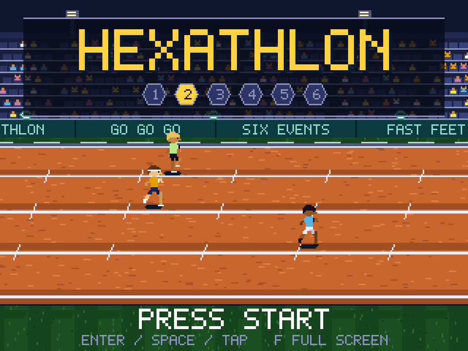
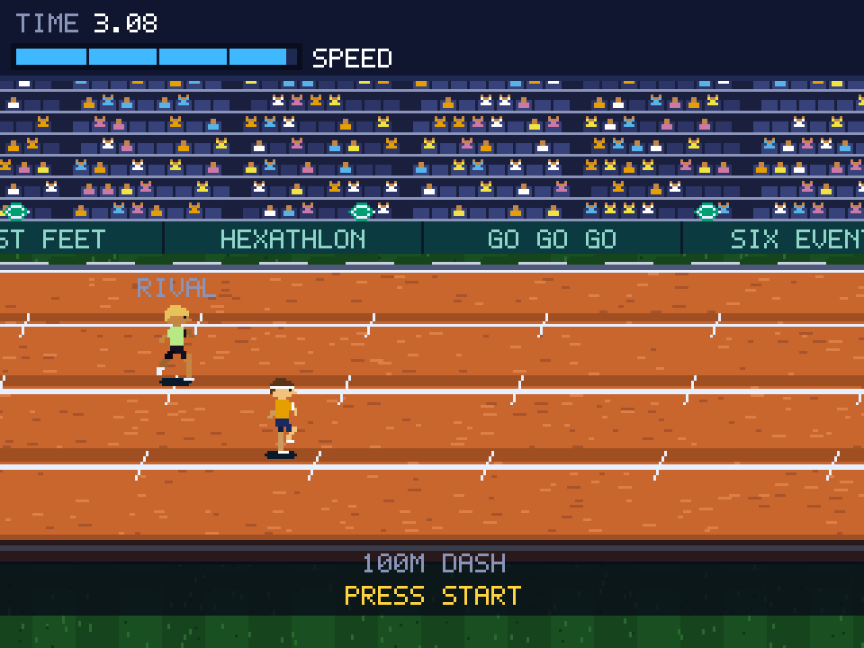
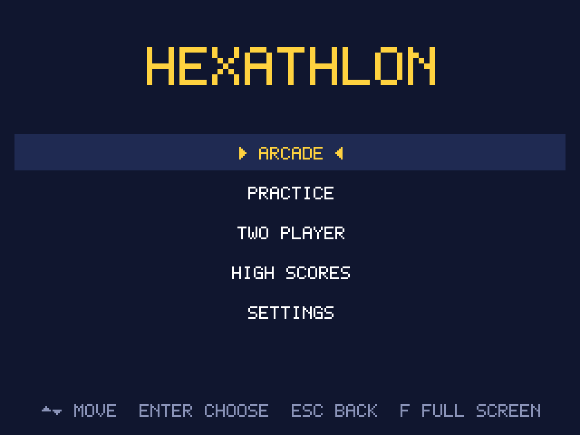
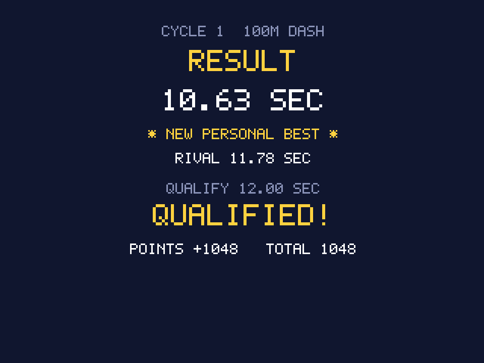
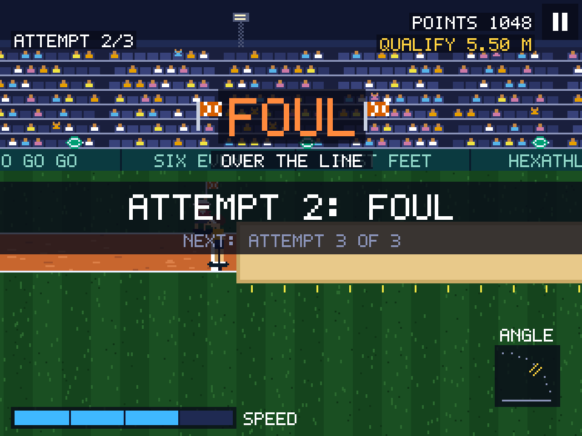
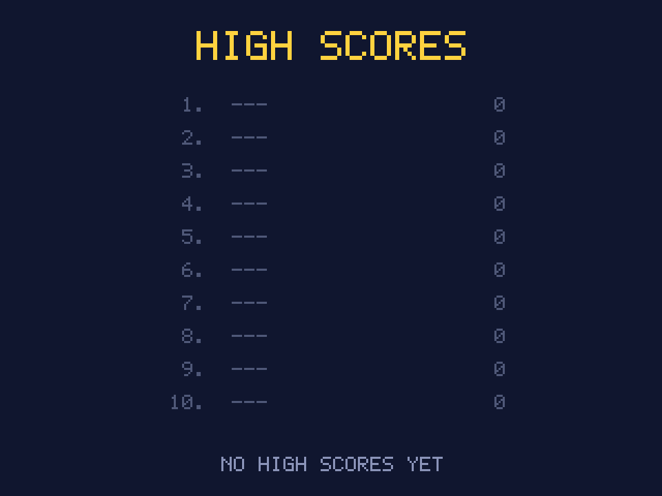
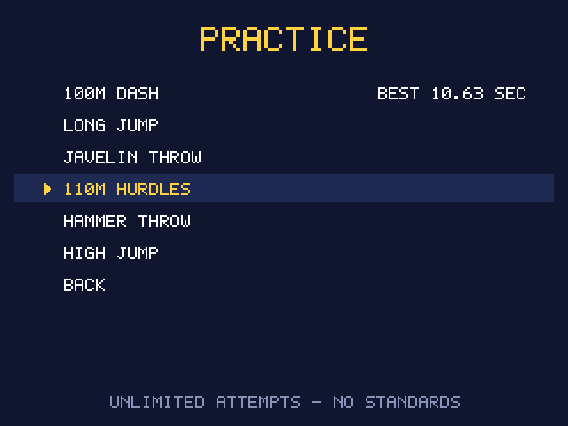
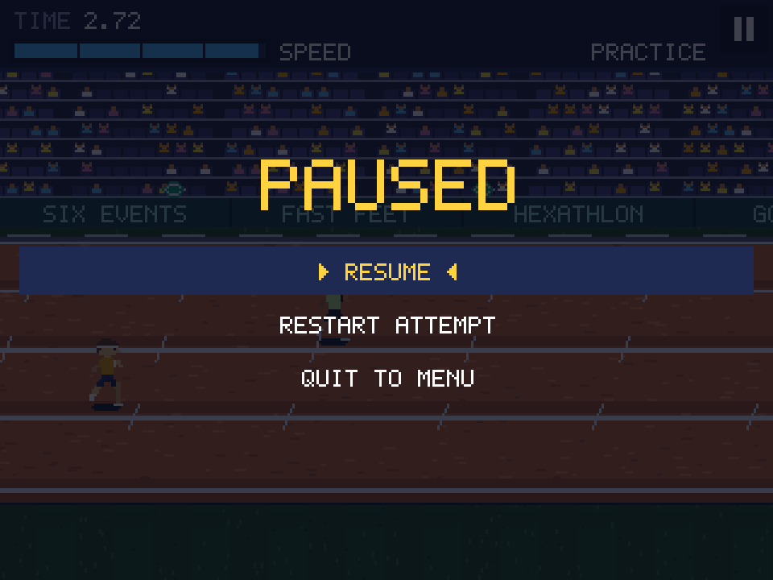

# How to play

[Back to README](../../README.md)

This page covers the game flow: the title, the menus, Arcade Sessions,
Practice and the High Score table. How each Event plays is in
[Events](events.md), and the keys and buttons are in [Controls](controls.md).

## The basics

Every Event uses the same three player controls:

| Control | Keyboard (player 1) | What it does |
|---|---|---|
| RUN A, RUN B | `Z`, `X` | Press them in turn to build speed |
| ACTION | `C` | Jump, throw or take off. In the field Events, hold it to raise the angle and let go to commit |

Speed comes from **alternating** the two run keys. Each press of the other
key adds speed; pressing the same key twice in a row adds nothing. Holding a
key down does not repeat it. The speed meter drains every frame, so you have
to keep mashing.

## Title screen

The title plays the Hexathlon theme. Press `Enter`, `Space`, `C` (ACTION),
a pad's Start, or tap the screen to open the main menu.

### Attract Mode

Leave the title alone for 10 seconds and it shows the High Score table for
8 seconds, then Attract Mode: a silent demo that replays a recorded Input
Trace of each Event in turn, then returns to the title. Any key, button or
tap goes straight back to the title.

The demo traces are listed in `data/attract.json`. The ones in
`data/attract/` are synthetic, made by `pnpm attract`; captured traces from
`calibration/traces/` can be added as they land.

## Main menu

| Item | What it does |
|---|---|
| ARCADE | Starts a Session at the 100m Dash |
| PRACTICE | Pick any Event and play it with no Standards |
| TWO PLAYER | Starts a two-player Session on one keyboard. Hidden on touch-only devices |
| HIGH SCORES | Shows the High Score table |
| SETTINGS | See [Settings](settings.md) |

Arrow keys move, `Enter` (or ACTION) chooses and `Esc` goes back to the
title. You can also tap a row.

## Arcade Sessions

A Session plays the six Events in order. Each Event has a **Standard**: the
Mark you must reach to qualify, shown as `QUALIFY` on screen.

- Reach the Standard and the next Event follows.
- Clear all six and a new **Cycle** starts at the 100m Dash, with tougher
  Standards.
- Miss a Standard (including a foul, a false start or no clearance in the
  High Jump) and the Session is over. There are no continues.

Before each Event an intro card shows the Cycle, the Event's name, "EVENT n
OF 6", the Standard, the difficulty and your Points so far. At the start of a
Session it lasts as long as the intro fanfare; before later Events it lasts
2 seconds. `Enter`, ACTION or a tap skips it.

During the Event, the top right of the screen shows your Session `POINTS` and
the `QUALIFY` Mark.

In the Long Jump, Javelin Throw and Hammer Throw you get three Attempts and
your best valid Mark counts. As soon as a Mark reaches the Standard, the
Event ends there and the remaining Attempts are skipped
(`"remainingAttempts": "skip"` in `data/standards.json`). Between Attempts
the last Mark shows for 1.5 seconds with "NEXT: ATTEMPT n OF 3".

A Session keeps the difficulty it started with, even if you change it in
Settings mid-Session.

### Standards

Standards come from `data/standards.json`, per Event and per Cycle. Cycles
past the three listed move by a fixed step each Cycle until they reach a
limit. At Normal difficulty they are:

| Event | Cycle 1 | Cycle 2 | Cycle 3 | Limit |
|---|---|---|---|---|
| 100m Dash | 12.00 s | 11.50 s | 11.10 s | 10.50 s |
| Long Jump | 5.50 m | 6.00 m | 6.49 m | 7.15 m |
| Javelin Throw | 50.00 m | 58.00 m | 65.00 m | 78.00 m |
| 110m Hurdles | 14.00 s | 13.33 s | 12.83 s | 11.67 s |
| Hammer Throw | 45.00 m | 50.40 m | 54.90 m | 64.80 m |
| High Jump | 1.70 m | 1.90 m | 2.00 m | 2.20 m |

Times qualify at or under the Standard, distances and heights at or over it.
Easy makes every Standard 10% easier and Hard 8% tougher (see
[Settings](settings.md#difficulty)). These values are provisional.

### Points

Every valid Mark earns Points. The rule for each Event is in
`data/points.json`:

> Points = (Mark − zero) × perUnit, rounded, never below zero

The Mark is in sim units (frames for times, the original's pixels for
distances and heights). Times have a negative `perUnit`, so faster earns
more. A foul, a false start or no clearance in the High Jump earns nothing.
The values are provisional and set so a strong Mark earns about 1000 Points
in every Event.

A Session's Points are the sum across every Event it played, the last one
included.

### Results

After each Event the results screen shows:

- the Event's Mark (or FOUL, FALSE START or NO MARK);
- `* NEW PERSONAL BEST *`, or your Personal Best for the Event;
- the Rival's time (100m Dash and 110m Hurdles), every Attempt (Long Jump,
  Javelin Throw, Hammer Throw), or each bar height with `O` for a clearance
  and `X` for a failure (High Jump);
- in Arcade: the Standard, `QUALIFIED!` or `NOT QUALIFIED`, the Points
  earned and the Session total, and either `NEXT: CYCLE n` after the High
  Jump or `GAME OVER`.

Press `Enter`, ACTION or tap to go on. Input is ignored for the first half
second, so a late mash doesn't skip the screen.

When the Session is over and its total is above zero and good enough for the
table, you enter your initials. Otherwise the game returns to the title.

## High Scores and initials

A High Score is a Session's Points total with three initials. Each initial
can be A to Z, 0 to 9, a full stop or a space.

- **Keyboard:** type a letter or digit (it fills the slot and moves on), or
  use Up and Down to change the current letter and Left and Right to move.
  `Enter` confirms each letter and saves after the third. `Esc` or
  `Backspace` steps back a letter.
- **Touch:** tap the arrows above and below a letter, tap a letter to move to
  it, and tap END to save.

The table keeps the top 10 totals. A total gets in while the table has a free
row, or when it beats the lowest row. A tie ranks below the existing entry.
Your new row is marked and highlighted. Any key or tap closes the table.

High Scores and Personal Bests are shared across difficulty levels, and are
kept in local storage on your device only.

## Personal Bests

The best Mark you have ever made in each Event is saved as a Personal Best,
in Arcade and Practice alike. The results screen tells you when you set a new
one, and the Practice menu lists each Event's best.

## Practice

Practice lists the six Events with your Personal Best beside each. Pick one to
play it with no Session, no Standard and no Points. `PRACTICE` shows in the
top right while you play.

Each go in the Long Jump, Javelin Throw and Hammer Throw is a single Attempt.
The High Jump plays its full rising-bar series. After each go the results
screen offers TRY AGAIN, CHOOSE EVENT or MAIN MENU, so Attempts are
unlimited.

## Pause

Pause an Event with `P` or `Esc`, a pad's Back/Select or Start button, or the
pause icon in the top right (tap or click it). The keyboard's `Enter` and
`Space` do not pause, so they can't pause by accident.

The Event also pauses on its own when the page is hidden, for example when
you switch tabs or put the app in the background.

| Pause menu item | What it does |
|---|---|
| RESUME | Carries on from exactly the same frame |
| RESTART ATTEMPT | Practice only: starts the go again |
| QUIT TO MENU | Abandons the Event (and in Arcade, the Session) and returns to the main menu |

`P` or `Esc` also resumes.

## Two Player

Two Player plays a full Arcade Session for two people on one keyboard (or
two gamepads). Player 1 uses `Z` `X` `C` and player 2 uses `,` `.` `/`.

- **Running Events** (100m Dash, 110m Hurdles): both players race side by
  side, each in their own lane, with no Rival.
- **Field Events**: the players take turns, Attempt by Attempt.
- **Standards**: a player who misses the Standard is out. The Session carries
  on while either player is still in, and ends once both are out.
- **Points**: each player has their own Points total. The results screen
  shows each player's Mark, whether they qualified, the Points they earned
  and their total.
- **High Scores**: at the end of the Session, each player whose total
  qualifies enters their initials in turn, player 1 first.

The rules (lanes, how field turns alternate, when the Session ends) live in
`data/two-player.json` and are **provisional** until the original's
structure is captured (`calibration/notes/two-player.md`). Touch plays one
player only, so Two Player is hidden on touch-only devices.
