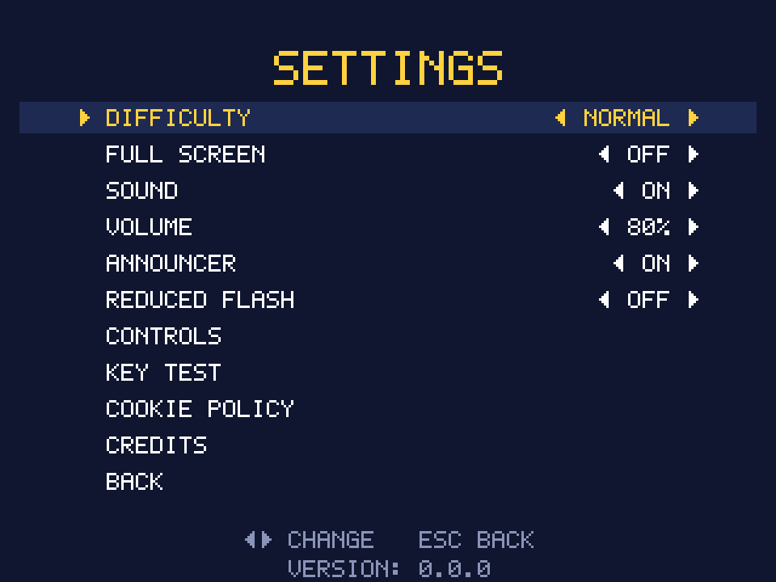
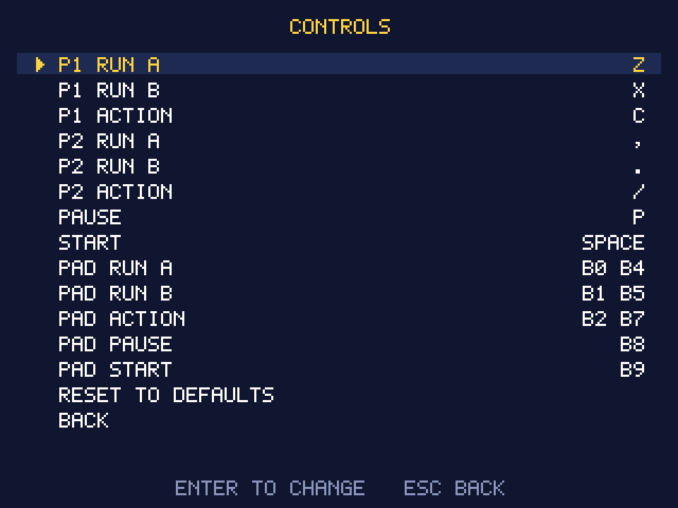
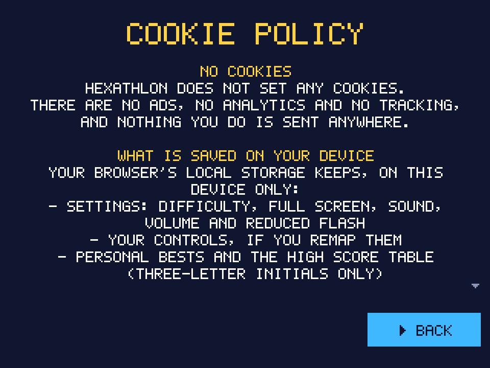
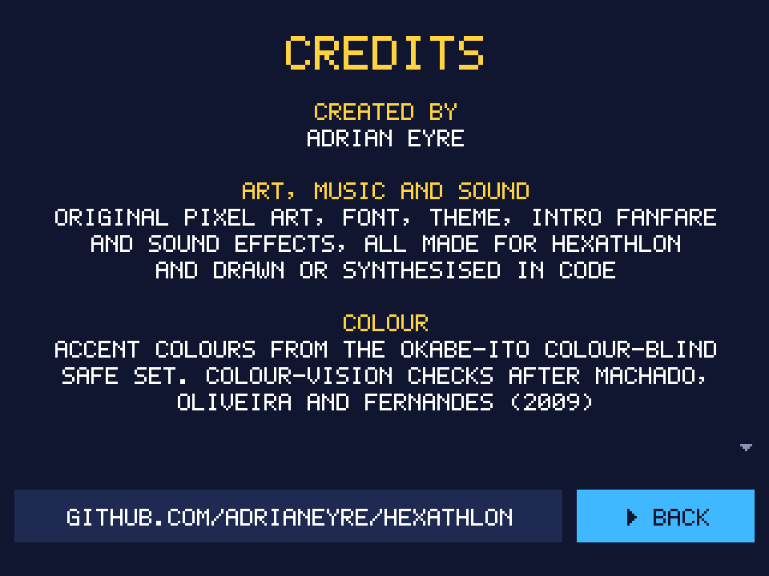

# Settings

[Back to README](../../README.md)

Open Settings from the main menu. Up and Down move, Left and Right change a
value, `Enter` (or ACTION) opens a page, and `Esc` goes back. On a touch
screen, tap the left or right end of a value row to change it. Every change
is saved and applied at once.

| Item | Values | Default |
|---|---|---|
| DIFFICULTY | EASY, NORMAL, HARD | NORMAL |
| FULL SCREEN | ON, OFF | OFF |
| SOUND | ON, OFF | ON |
| VOLUME | 0% to 100%, in steps of 10% | 80% |
| ANNOUNCER | ON, OFF | ON |
| REDUCED FLASH | ON, OFF | OFF (ON if your system asks for reduced motion) |
| CONTROLS | Opens the remap screen | |
| KEY TEST | Opens the Key Test screen | |
| COOKIE POLICY | Opens the Cookie Policy | |
| CREDITS | Opens the Credits | |
| BACK | Back to the main menu | |

Along the bottom, `VERSION: x.y.z` names the release you are playing (the
version in `package.json`, set by each release; see
[Deployment](deployment.md#releases)).

## Difficulty

Normal plays every Event exactly as `data/events.json` and
`data/standards.json` say. It is the level parity is measured on, and the
only one the replay harness runs. Easy and Hard scale a few values from
`data/difficulty.json`
([ADR-0005](../architectural-decision-record/0005-difficulty-levels-scale-normal.md)):

| Factor | Easy | Normal | Hard |
|---|---|---|---|
| Speed per run press | ×1.2 | ×1 | ×0.9 |
| Rival's pace | ×0.92 | ×1 | ×1.05 |
| Standards | 10% easier | as listed | 8% tougher |
| Angle windows, and the Hammer's release window | 4° wider each side | as listed | 2° narrower each side |
| Hurdle clear window | 3 frames wider each side | as listed | 2 frames narrower each side |

Distances, foul lines, hurdle positions and bar heights never change, so
Marks stay comparable across levels. Personal Bests and High Scores are
shared across levels.

A change applies from the next Event you start. An Arcade Session keeps the
level it started with, so changing it mid-Session can't help you qualify.
The intro card before each Arcade Event shows the level.

## Full Screen

Press `F` at any time to turn it on or off, or choose FULL SCREEN in
Settings (the only way on a touch screen or gamepad). The title screen and
main menu show `F FULL SCREEN` as a reminder. `F` is ignored while you type
initials, remap keys or use the Key Test, and when it is remapped to a game
control.

ON makes the game fill 100% of the screen, stretched to fit with no black
bars, in the browser's full-screen mode where it has one. OFF shows the
320x240 picture letterboxed at the largest whole-number scale that fits, so
every pixel is the same size (very small screens use a fractional scale so
the whole picture stays visible).

Leaving full screen with the browser's own control (for example `Esc`)
turns the setting off. The choice is remembered, but a browser only enters
full screen after a key press or tap, so it comes back on your first key
press or tap.

## Sound and Volume

SOUND turns all audio on or off. VOLUME sets the level. All music and sound
effects are synthesised with Web Audio as the game runs: the title theme,
the intro fanfare that opens a Session, the starting pistol, footsteps, the
crowd, the finish, a buzz for a foul, a clatter for a hit hurdle or a
knocked bar, menu sounds and a sound for a new Personal Best.
Browsers only allow audio after a user gesture, so nothing plays until your
first key press or tap. Attract Mode is silent.

## Announcer

The announcer calls the action, as in the arcade originals: the Event's name
as it begins, "On your marks" and "Get set" before the gun, "False start",
"Foul", "Failed" (a High Jump failure), "Qualify" when a Mark reaches the
Standard, "Not qualified", "New record" for a Personal Best, "Game over",
and "Player one" or "Player two" when players take turns. The phrases are in
`data/callouts.json` (provisional until checked against a capture of the
original). They are spoken by the browser's built-in speech synthesis, so
there are no recordings; the voice is whichever one your system provides,
and where there is none the game is simply silent. The announcer follows
SOUND and VOLUME, and ANNOUNCER turns it off on its own.

## Reduced Flash

ON stops blinking text (such as PRESS START), holds the title's hexagons
steady, and holds the crowd still. On a first visit it starts ON if your
system asks for reduced motion. See [Accessibility](accessibility.md).

## Controls and Key Test

CONTROLS remaps the keyboard and gamepad. KEY TEST shows which keys your
keyboard registers when held together. Both are described in
[Controls](controls.md#remapping).

## Cookie Policy

A short page that says Hexathlon sets no cookies, has no ads, analytics or
tracking, and sends nothing anywhere. It lists what is kept in local storage
(below), says the game keeps a copy of its own files for offline play, and
explains that clearing the site's data in the browser removes all of it.

Up and Down scroll (or tap the top or bottom half of the text). `Esc` or
BACK returns to Settings.

## Credits

Who made the game, where the art, music and sound came from, the colour
sources, what it is built with, and the licence. It has a link to the
repository (<https://github.com/adrianeyre/hexathlon>), which opens in a new
tab: Left and Right move between the link and BACK, and `Enter` or ACTION
picks. The full record of provenance is in [CREDITS.md](../../CREDITS.md).

## What is stored

Everything is kept in the browser's `localStorage`, on your device only.
Each value is stored under a `hexathlon:` key, in an envelope with a schema
version (currently 1).

| Key | What it holds |
|---|---|
| `hexathlon:settings` | Difficulty, full screen, sound on or off, volume, the announcer and reduced flash |
| `hexathlon:controls` | Your key and pad bindings, if you remap them |
| `hexathlon:personal-bests` | Your best Mark per Event, in sim units |
| `hexathlon:high-scores` | The top 10 Session totals with three-letter initials |

If local storage is missing, blocked or full, the game keeps working with an
in-memory store for the visit. Corrupted or out-of-range values fall back to
the defaults field by field. The service worker also keeps a copy of the
game's files in the browser's cache storage for offline play (see
[Installing and offline play](installing-and-offline.md)).

To clear everything, clear this site's data in your browser's settings.
