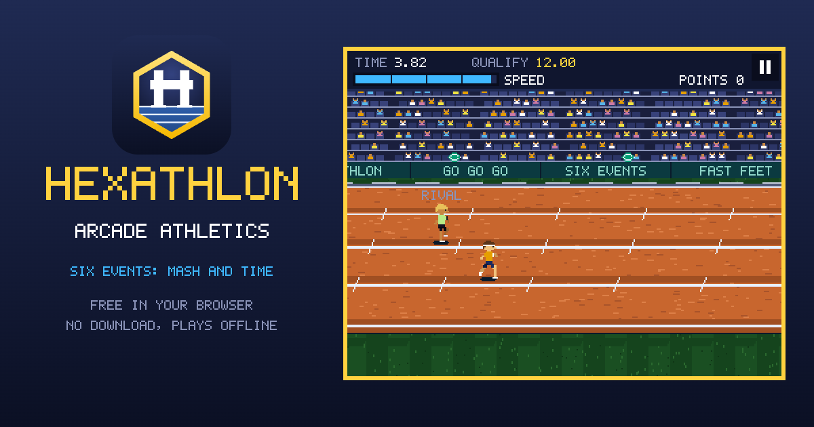
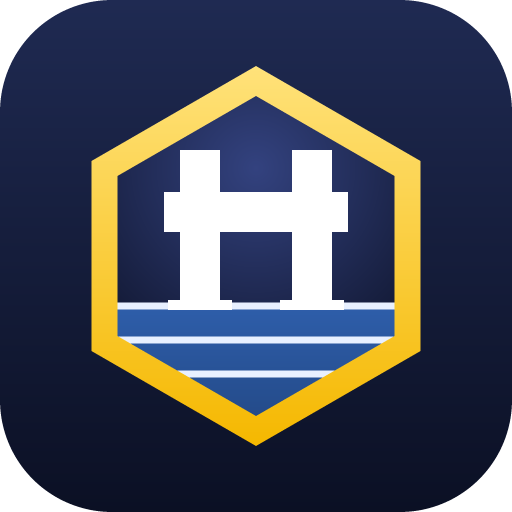

# SEO, social previews and icons

[Back to README](../README.md)

How Hexathlon presents itself to search engines, to social networks and
chat apps when its link is shared, and to every platform's home screen, tab
bar and taskbar. Everything here is plain files in the repository, because
the site has no build step, and `test/seo.test.ts` and `test/pwa.test.ts`
check it on every push.



## The site address

The deployed site lives at **<https://adrianeyre.github.io/hexathlon/>**
(GitHub Pages for the `hexathlon` repository; see
[Deployment](guide/deployment.md)). Social networks and search engines need
absolute URLs, so that address is written into `index.html`, `robots.txt` and
`sitemap.xml`. If the site moves (a custom domain, say), change it in all
three and in `SITE` at the top of `test/seo.test.ts`; the tests fail until
they all agree.

## Search engines

In `index.html`:

| What | Why |
|---|---|
| `<title>` (30 to 60 characters) and `<meta name="description">` (120 to 200) | The headline and snippet in search results, at lengths that aren't cut off |
| `<html lang="en-GB">`, `hreflang` links | The page's language, so it is shown to the right searchers |
| `<link rel="canonical">` | The one address to index, whatever query string or mirror the page was reached by |
| `<meta name="robots" content="index, follow, max-image-preview:large, ...">` | Allows indexing and large image previews |
| A visually hidden `<h1>` and summary paragraph | The game is a canvas, which crawlers and screen readers can't read; this gives them the same pitch in text. It is hidden with the standard `.visually-hidden` pattern in `css/style.css`, which keeps it in the accessibility tree |
| `<noscript>` message | What to do if JavaScript is off |
| JSON-LD structured data | A schema.org `WebSite` and a `VideoGame` + `WebApplication` that names the six Events, the genre, the platforms, the 1 to 2 players, the price (free), the licence, the author and the repository. Search engines can use it for rich results |

`robots.txt` allows every crawler and points at `sitemap.xml`, which lists
the page and its share image.

The game also loads fast and works offline (under 2 MB, an estimated 0.8 s
on broadband: see `pnpm size` and `pnpm perf` in
[Development](guide/development.md)). Speed is a ranking signal too.

## Social sharing previews

When the link is pasted into Facebook, LinkedIn, WhatsApp, Slack, Discord,
Teams, iMessage, Telegram, Mastodon, Bluesky or X, they read these tags to
show a title, a description and an image:

- **Open Graph** (`og:*`): type, site name, locale, URL, title, description
  and the image, with its secure URL, type, size (1200x630) and alt text.
- **X (Twitter) card** (`twitter:*`): `summary_large_image`, with the same
  title, description and image.

The image is [`images/social-card.png`](../images/social-card.png): 1200x630
(the 1.91:1 shape every network crops to), under 1 MB, with the logo, the
name and a short pitch in the game's own pixel font beside a shot of the
100m Dash. It is made by `pnpm screenshots` (below), so it always shows the
current game.

To check a preview after deploying, paste the URL into the networks' own
debuggers: Facebook's Sharing Debugger, LinkedIn's Post Inspector, or a
draft post on X. They cache previews, so ask them to scrape again after a
change.

## The logo and icons

The logo is a gold hexagon (the six Events) around a floodlit night sky over
a blue running track, with a hurdle standing on the track that also reads as
an **H**. Its colours are the [style guide](style-guide.md)'s: interface
gold `#ffd23f`, panel and background navy `#1f2a52` and `#10162f`, track blue
`#2e5eaa` and lane white `#e8f0ff`.

| Full mark | Small-size mark | Maskable (Android) | Monochrome |
|---|---|---|---|
|  |  |  |  |

Like the rest of the game's art it is defined in code, with no image editor
or third-party asset: `tools/icon-art.ts` holds the geometry once and draws
it two ways, as SVG and as anti-aliased PNG (supersampled up to 16x16 times
per pixel). Below 64 px a bolder version with fewer lane lines keeps the
hurdle readable. Run `pnpm icons` after changing the art; `test/pwa.test.ts`
fails if any committed file is stale.

### What each platform gets

| Platform | Files | Linked from |
|---|---|---|
| Every browser tab | `favicon.ico` (16, 32 and 48 px in one file), `icons/favicon.svg` (sharp at any size) | `<link rel="icon">` |
| Browsers and Google Search | `icons/favicon-16x16.png`, `-32x32`, `-48x48`, `-96x96` (Google wants a multiple of 48 px) | `<link rel="icon" sizes>` |
| iPhone and iPad home screen | `icons/apple-touch-icon.png` (180 px) and 167, 152 and 120 px versions, on a full-bleed square because iOS rounds the corners itself | `<link rel="apple-touch-icon">` |
| Android, ChromeOS, Windows and macOS installs | `icons/icon-192.png`, `icon-512.png`, `icon-maskable-192.png` and `icon-maskable-512.png` (the mark inside the 80% safe zone for adaptive shapes), `icon-monochrome-512.png` (Android themed icons) and the SVG | `manifest.webmanifest` |
| Windows Start tiles | `icons/mstile-70x70.png`, `150x150`, `310x150` and `310x310` on the tile colour `#10162f` | `browserconfig.xml` |
| Safari pinned tabs and the Touch Bar | `icons/safari-pinned-tab.svg`, one colour | `<link rel="mask-icon">` |
| Anything else (stores, press, structured data) | `icons/icon-1024.png` and `icons/icon.svg` | Not linked |

The install dialog on Android and desktop Chrome also shows the manifest's
`screenshots`. Every icon the page or manifest links is in the service
worker's `ASSETS`, so it works offline too.

## Screenshots

`pnpm screenshots` plays the real game in headless Chrome and saves every
screenshot in [`screenshots/`](screenshots/) and the social card. It drives
Chrome over the DevTools protocol with the helpers from
`tools/perf-check.ts`, so it needs no dependencies; set `CHROME` to choose
the browser. Each game shot is the 320x240 canvas scaled 3x with
nearest-neighbour, so the pixel art stays crisp (960x720). The touch shot is
the whole page on an emulated landscape phone, with the on-screen buttons.

```sh
pnpm screenshots                    # every shot and the social card
pnpm screenshots hurdles settings   # only these
pnpm screenshots social-card        # the 100m again, and the card
```

It plays in real time, so a shot can come out a little different each run.
Look at them before committing.
