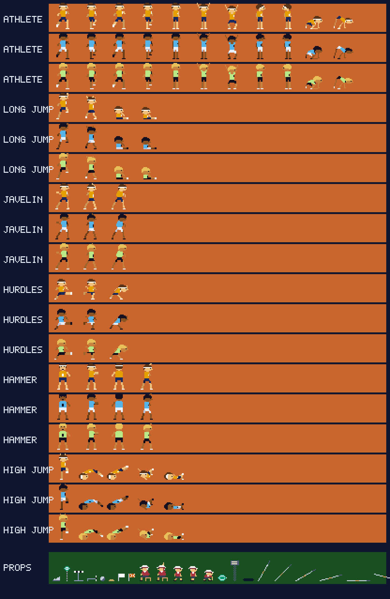
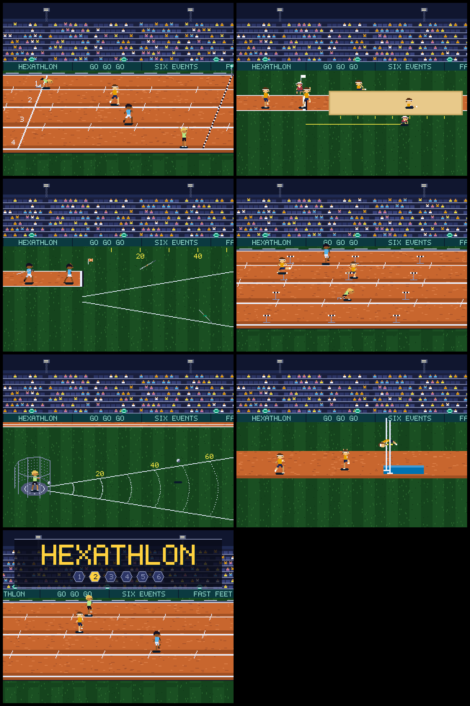
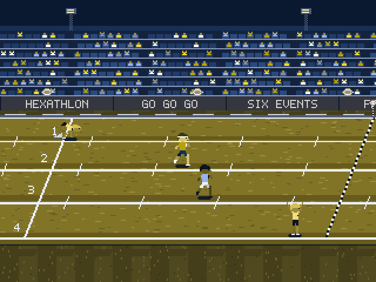
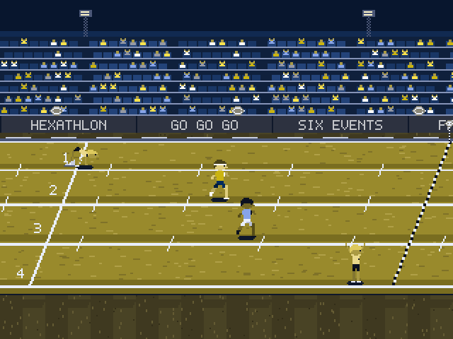
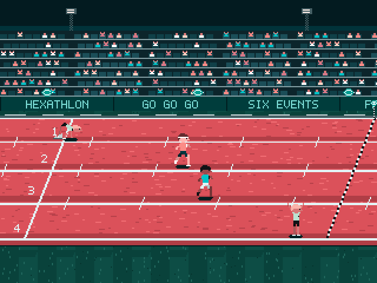
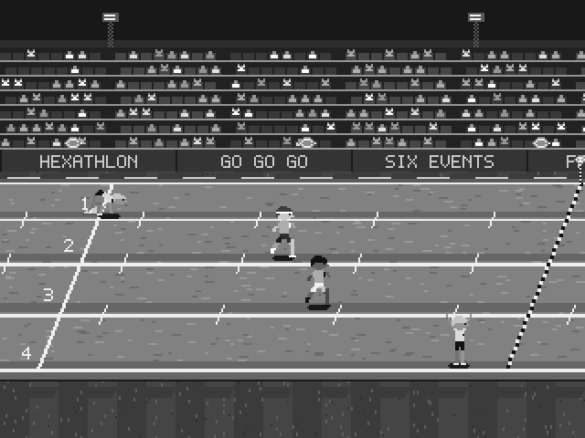

# Hexathlon style guide

**Status:** Draft for owner approval (issue #27).

This guide defines Hexathlon's look before any Event is drawn: the palette,
the athletes, the stadium, the crowd and the title. It applies PRD §7.5:
the mechanics match the arcade original by measurement, but everything you
see and hear is original work, and deliberately different from it
(ADR-0001, ADR-0002).

The rules here are also data in the code, so tests hold the art to them:

| Rule | Where it lives | Checked by |
|---|---|---|
| Palette and kits | `src/art/colours.ts` | `test/style-guide.test.ts` (colour blindness), `test/art.test.ts` (every drawn colour is in the palette) |
| Proportions, frame counts, animation timing | `src/art/style.ts` | `test/art.test.ts` |
| Athlete and Event sprites | `src/art/*.ts` | `test/art.test.ts` |
| Title | `src/render/title-art.ts` | `test/accessibility.test.ts` (reduced flash) |

Run `pnpm sprites` to redraw the review images below from the code.

## 1. Look and feel

An **evening meet under floodlights**. A navy night sky, an orange-brown
track with white lane lines on mown green grass (both textured with grain
and blades, as on the arcade originals of the genre), a banked stand of seat
blocks with a sparse, waving crowd, and tall, lanky cartoon athletes. Low-resolution pixel art on a 320x240
canvas, every pixel drawn in code (no image files are loaded).

## 2. Palette

All colours are named in `src/art/colours.ts` (art) and
`src/render/palette.ts` (interface). Code refers to names, never to hex
values, so the palette can be retuned in one place.

| Group | Colours |
|---|---|
| Sky and stand | sky `#10162f`, sky glow `#1f2a52`, floodlight `#fff6c8`, stand `#1a1f3d`, seats `#2c3566` / `#38427a`, rails `#8a93b8` |
| Wall | wall `#0b3a40`, wall text `#8fd6c8` |
| Crowd | tops `#e69f00`, `#56b4e9`, `#f0e442`, `#cc79a7`, `#ffffff`; banners `#009e73` |
| Ground | track and runways `#c8662e` (shade `#a04f22`, grain `#dd8048` and `#a8532a`), lane lines `#e8f0ff`, grass `#1a4f22` (mown stripe `#15441d`, blades `#2b6a2f` and `#0f3616`), sand `#e8c98a` (rim `#c9a965`) |
| Markings | board `#ffffff`, foul strip `#141020`, foul flag `#d55e00`, sector lines `#e8f0ff`, distance markers `#f0e442` |
| Equipment | hurdle `#ffffff` / `#141020` / `#8a93b8`, bar `#f0e442` / `#141020`, uprights `#e8f0ff`, mat `#0072b2` / `#3f9ad6`, metal `#c8d0e0` / `#4f5878`, grip `#d9a066` |

### Colour-blind safety

The colours that carry meaning (kits, foul strip, markers, the bar) come from
the Okabe-Ito set, which was designed to stay distinct for the common kinds
of colour blindness. The rule, enforced by `test/style-guide.test.ts` on
every pair listed in `MUST_DIFFER`:

- **ΔE ≥ 20** (CIE76) between the two colours for normal vision and for
  simulated protanopia, deuteranopia and tritanopia (Machado et al. 2009).
- **ΔE ≥ 10** with no colour vision at all (achromatopsia), unless the pair is
  also told apart by shape. The three kits are: they differ in headband, bib
  and shorts as well as vest colour, and the HUD labels the lanes.
- Interface text is at least **4.5:1** against the backgrounds it is drawn on.

Meaning never rests on hue alone: the foul flag has a cross on it, the
finish line is chequered, the selected menu item has arrows and a bar, and
held touch buttons fill in.

The 100m still as seen with each type of colour blindness:

| Protanopia | Deuteranopia | Tritanopia | Achromatopsia |
|---|---|---|---|
|  |  |  |  |

## 3. Athletes

### Proportions

16x28 pixels upright, side view facing right, feet on the bottom row
(`PROPORTIONS` in `src/art/style.ts`). The frames are drawn 22 rows tall and
stretched by `defineTallSprite`, which doubles every other row below the neck,
giving the tall, lanky build of the arcade originals:

| Rows | Part |
|---|---|
| 0-6 | Head: a quarter of the height, with a headband across row 3 and one eye pixel |
| 7 | Neck |
| 8-14 | Vest, with a bib on the chest |
| 15-27 | Shorts and legs, shoes on row 27 |

Near limbs use the skin colour and far limbs a shaded skin, so arms and legs
read even at this size. Sprites are drawn with colour *roles*, not colours,
so one set of frames serves every athlete.

### Outfits (kits)

| Who | Vest | Bib | Headband | Shorts | Shoes | Skin and hair |
|---|---|---|---|---|---|---|
| Player 1 | orange `#e69f00` | white | white | navy | white | light skin, brown hair |
| Player 2 | sky blue `#56b4e9` | black | black | white | black | dark skin, black hair |
| Rival (CPU) | lime `#b8e986` | black | none | black | pale | medium skin, fair hair |

Two-player puts player 2 in the Rival's lane, so the CPU Rival and player 2
never appear together.

The officials (the Long Jump's foul judge and measurer) wear their own
outfit, `OFFICIAL` in `colours.ts`: a white hat, a red blazer over a white
shirt, and grey trousers. They are not athletes, so they aren't in `KITS`.

### Animation frame counts

From `FRAME_COUNTS` in `src/art/style.ts`; the tests check every module
provides exactly these.

| Animation | Frames | Module |
|---|---|---|
| Run cycle (contact, passing, contact, passing) | 4 | `athlete.ts` |
| Start crouch (on your marks, set) | 2 | `athlete.ts` |
| Stand, cheer | 1 each | `athlete.ts` |
| Celebrate (in the air, landing between jumps) | 2 | `athlete.ts` |
| Dejected (head bowed and turned one way, then the other) | 2 | `athlete.ts` |
| Foul judge (watching, flag raised) | 2 | `officials.ts` |
| Measurer walking, and crouched at the mark | 2, 1 | `officials.ts` |
| Long Jump take-off, flight (hang, sail), landing | 1, 2, 1 | `long-jump.ts` |
| Javelin throw (wind-up, release, follow-through) | 3 | `javelin.ts` |
| Javelin in flight, one per 15° from +60° to -60° | 9 | `javelin.ts` |
| Hurdle clearance (lead leg, trail leg), stumble | 2, 1 | `hurdles.ts` |
| Hammer spin (front, side, back, side mirrored), release | 4, 1 | `hammer.ts` |
| High Jump take-off, clearance (arch, kick), knock, landing | 1, 2, 1, 1 | `high-jump.ts` |

Timing (`FRAME_TIMING`): a run-cycle step lasts from 10 frames (barely
moving) down to 3 frames (top speed), so the legs speed up with the athlete;
the hammer spin the same, from 12 to 3. The crowd waves in 12-frame steps.

## 4. Stadium, track and crowd

Drawn in code in `src/art/stadium.ts` from these layers, back to front, each
scrolling at its own speed as the camera follows the athlete:

1. **Sky** (scrolls at 0.1): navy, with a band of floodlight glow above the stand.
2. **Floodlight towers** (0.25): lattice poles with lamp banks, every 200 pixels.
3. **Stand** (0.5): seven stepped rows of seat blocks in alternating shades,
   with aisles. About half the seats hold a fan, a 4x5 figure in one of five
   tops. Fans stand and wave in turn, more of them as the crowd gets
   excited. Hexagon banners (the game's emblem) hang from the front.
4. **Wall** (1.0): advertising boards with original slogans (HEXATHLON,
   GO GO GO, SIX EVENTS, FAST FEET), no real brands.
5. **Ground**: the track in perspective, seen from high in the stand: four
   lanes that get taller towards the viewer (20, 24, 28 and 32 pixels),
   lines that thicken nearer, a kerb along the far edge, the track's near
   face, a darker camber band, and start, finish and distance lines that
   lean (`trackShear`). Or the runway, sand pit and officials; the Hammer's
   overview of the caged circle and the sector with its distance arcs; the
   Javelin's landing field; or the high-jump apron and mat, per Event.

**Reduced flash** freezes the crowd (no waving) and the title's hexagons
(all lit). Nothing in the art flashes or strobes in any setting.

## 5. Title

The HEXATHLON logo in large pixel letters with a drop shadow, on a dark panel
over the floodlit stand. Under it, six hexagons numbered 1 to 6, one per
Event, lit one at a time. Athletes in all three kits jog laps of the track
below, and "PRESS START" blinks underneath (steady with reduced flash).

The theme (`THEME` in `src/audio.ts`) is an original eight-bar march in
C major at 150 bpm: a square-wave lead over a triangle bass, built from a
rising arpeggio call and stepwise answers. It was written for Hexathlon and
does not quote or paraphrase any film, classical or game melody.

## 6. How it differs from the original

The arcade original is only a reference for mechanics. Each element below
was chosen to be unlike the familiar look of the genre's 1980s arcade games
(a daytime stadium, a red-brown track on bright green grass, a packed crowd
backdrop, realistically proportioned athletes). The "avoids" column is the
design intent, written from general knowledge of the genre rather than from
side-by-side study; check each row against the reference during the
original-asset audit (#64), and change the art here if any row doesn't hold.

| Element | Hexathlon | Avoids |
|---|---|---|
| Time of day | Evening meet: navy sky, floodlight towers, glow band | A daytime stadium |
| Palette | Orange-brown textured track on dark, textured green grass under a night sky, Okabe-Ito accents | A daytime palette, or any original's exact colours and tiles |
| Athletes | Tall cartoon build: head a quarter of the height, headband, bib | Copying any original's sprites |
| Outfits | Three kits differing in vest, bib, headband and shorts | Kits that differ by colour alone |
| Rival | Its own look: no headband, lime vest, black bib and shorts | A recoloured copy of the player |
| Stadium | Stepped seat blocks with aisles, hexagon banners, slogan wall, parallax layers | A flat, continuous crowd backdrop |
| Crowd | Sparse: half the seats empty, small figures that stand and wave | A dense field of faces |
| Field Events | Mown stripes, fanned sector lines, numbered posts, officials' flags with a cross for a foul | Any of the original's field markings or indicators |
| Title | Hexathlon logo, six numbered hexagons, jogging athletes | The original's logo, title layout or attract screens |
| Font | Hexathlon's own 5x7 pixel font (`src/render/font.ts`) | The original's typeface |
| Music | Original procedural chiptune theme and jingles | The original's soundtrack, and film or classical tunes associated with the genre |

## 7. Approval

- [ ] Palette and kits approved
- [ ] Athlete design, proportions and frame counts approved
- [ ] Stadium, track and crowd approved
- [ ] Comparison notes reviewed
- [ ] Title and theme approved

Approved by: _______ Date: _______
